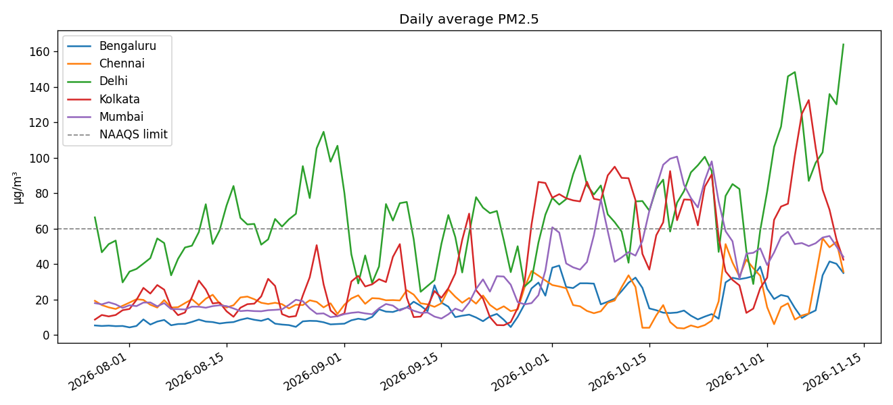
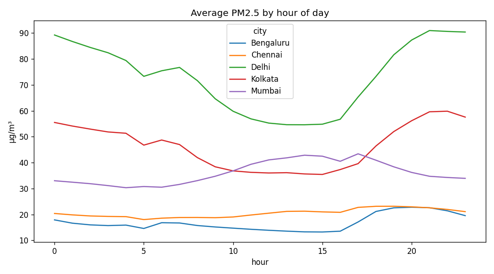

# AirLens: Air Quality Data Lifecycle Pipeline

An automated Python pipeline that collects hourly air-quality data for five Indian cities (Delhi, Mumbai, Bengaluru, Kolkata, Chennai), cleans and aggregates it in SQLite, measures it against India's PM2.5 legal limit, and serves the results in an interactive Streamlit dashboard. It covers the full data lifecycle: collect, store, clean, transform, analyse, share, archive, with every run audited.

A small forecasting experiment (next-day PM2.5) is included, with an honest evaluation (see [Forecast experiment](#forecast-experiment)).


## Team and my contribution

CHRIST University (Delhi NCR), 5 BCA A, *Data Engineering* course project. Team: **Hiten Mandhyan, Naman Jiwnani, Tejas Kashyap**.

**My contribution:** <!-- TODO (owner to fill in): what *you* personally built or decided, e.g. which modules, which analysis, what you debugged. Be specific and truthful; interviewers will ask. -->
`TODO: replace this line`

## Screenshots

<!-- TODO: add screenshots after running `streamlit run dashboard.py`, then delete this comment -->
| Headline and haze bands | Lifecycle rail and row ledger | Per-city trends vs the legal limit |
|---|---|---|
| `docs/screenshot-bulletin.png` (to add) | `docs/screenshot-lifecycle.png` (to add) | `docs/screenshot-trends.png` (to add) |

Sample generated charts (written summary in [reports/summary.md](reports/summary.md)):




## Architecture

```
                 Open-Meteo Air Quality API  (CAMS model data, no API key)
                                  |
                   fetch_city()  retries + exponential backoff (2s, 4s, 8s)
                                  |
        +-------------------------+--------------------------+
        |                                                    |
  data/raw/*.json                                 SQLite: data/air_quality.db
  immutable API snapshots                         raw_readings   (upsert on city+time)
  (deleted after 30 days)                                |
                                                 clean()  drop forecast hours, null negatives,
                                                          interpolate gaps <= 3 h, flag 3-sigma outliers
                                                         |
                                                 clean_readings -> transform() -> daily_summary
                                                         |                              |
                                          analyze() -> reports/        archive(): rows > 60 days
                                          summary.md + charts          -> archive_readings
                                                         |
                       pipeline_runs  (audit row for every run: status, counts, failing stage)
                                                         |
                          dashboard.py (Streamlit) reads the same database
                          bootstrap.py rebuilds it from the API if missing or > 24 h old
```

| Stage | What the code does | Where |
|---|---|---|
| Collect | Hourly PM2.5, PM10, NO2, US AQI for 5 cities, with retries; one failing city gives a `partial` run instead of aborting | `fetch_city()`, `collect()` |
| Store | Raw JSON snapshots plus idempotent upsert into `raw_readings` | `data/raw/`, `raw_readings` |
| Clean | Drop forecast hours, negatives to NaN, interpolate gaps of 3 h or less, flag values > 3 sigma from a centred 7-day rolling mean | `clean()`, `fill_short_gaps()` |
| Transform | Daily aggregates per city plus a US AQI category | `daily_summary` |
| Analyse | City ranking, worst days, share of days over the NAAQS limit, weekday vs weekend, peak hour, charts | `analyze()`, `reports/` |
| Share | Streamlit dashboard with CSV and Markdown downloads | `dashboard.py` |
| Archive | Rows older than 60 days move to `archive_readings`; raw JSON older than 30 days is deleted; `VACUUM` | `archive()` |
| Govern | Every run (including failures, with the stage name) is written to `pipeline_runs` and `pipeline.log` | `run()`, `pipeline_runs` |

## Run it

```bash
pip install -r requirements.txt            # pinned versions
python pipeline.py --backfill              # first time: last 92 days (Open-Meteo's maximum)
python pipeline.py                         # later runs: incremental (last 2 days)
streamlit run dashboard.py                 # http://localhost:8501
python forecast.py                         # forecast evaluation -> reports/forecast_results.json
```

The dashboard builds the database itself if `data/air_quality.db` is missing or its last successful run is over 24 hours old (it fetches 90 days, cached for an hour with `st.cache_data`), so a fresh clone needs only the `streamlit run` line.

Configuration: `AIRLENS_DB` (environment variable) overrides the database path; `events.json` lists dates to mark on the trend chart (currently Diwali 2026).

Schedule daily: Linux/Mac cron `0 7 * * * cd /path/to/air_quality_pipeline && python pipeline.py`; Windows Task Scheduler with action `python pipeline.py` (start in the project folder). The process exits with code 1 if a run fails.

## Tests and CI

```bash
pip install -r requirements-dev.txt
python -m pytest -q          # 62 tests, ~4 s; in-memory SQLite, mocked API, no network
```

Covered: gap interpolation (3 h limit), negative-value handling, 3-sigma outlier flag, forecast-hour removal, `aqi_category` boundaries, idempotent upserts (running twice never duplicates rows), daily aggregation, the 60-day archive and 30-day file retention, API retry/backoff and error classification, partial/failed run auditing in `pipeline_runs`, CLI exit code, the dashboard's stale-database logic, and the forecast code (leakage-free features, time split).

GitHub Actions (`.github/workflows/`): `tests.yml` runs pytest on every push and pull request; `daily-smoke.yml` runs the real pipeline against the live API every day at 07:00 IST and fails if the run or the data look wrong.

## Data source

[Open-Meteo Air Quality API](https://open-meteo.com/en/docs/air-quality-api): hourly concentrations derived from the Copernicus Atmosphere Monitoring Service (CAMS) model. These are **model estimates, not ground-station measurements** (CPCB station data may differ). Please read Open-Meteo's [terms](https://open-meteo.com/en/terms) and attribution requirements before reusing the data. The legal limit used is India's NAAQS 24-hour PM2.5 standard, 60 µg/m³.

## Key findings

Computed on 2026-11-12 from the 109 days 2026-07-27 to 2026-11-12 (545 city-days). The last day is incomplete (22 of 24 hours), so treat 12 Nov as provisional. Numbers change as new data arrives; rerun the pipeline to refresh them.

| Finding | Value | Source |
|---|---|---|
| Mean PM2.5 by city (µg/m³) | Delhi 69.4, Kolkata 42.2, Mumbai 33.4, Chennai 20.1, Bengaluru 15.3 | [reports/summary.md](reports/summary.md) |
| Share of days above the 60 µg/m³ limit | Delhi 59%, Kolkata 31%, Mumbai 12%, Chennai 0%, Bengaluru 0% | [reports/summary.md](reports/summary.md) |
| Peak hour of day (IST) | Delhi 21:00, Kolkata 22:00, Bengaluru 20:00, Chennai 19:00, Mumbai 17:00 | [reports/summary.md](reports/summary.md) |
| Delhi weekday vs weekend mean | 75.8 vs 66.3 µg/m³ (descriptive only, no significance test) | [reports/summary.md](reports/summary.md) |
| Pollution rises into winter | Delhi monthly mean 64.3 (Aug), 74.6 (Oct), 120.1 (1-12 Nov); Kolkata 20.6, 65.0, 79.8; Mumbai 15.2, 62.1, 50.8 | SQL below |
| Data quality | In the 92-day backfill run on 2026-11-12: 11,160 raw rows → 11,150 clean rows, 49 flagged outliers, 0 gap-filled values | `cleaned:` line of that run in `pipeline.log` (local, git-ignored) |

```sql
-- monthly means behind the "rises into winter" row (July is excluded: only 5 days)
SELECT city, substr(date,1,7) AS month, ROUND(AVG(avg_pm2_5),1) AS mean_pm25, COUNT(*) AS days
FROM daily_summary GROUP BY city, month ORDER BY city, month;
```

## Forecast experiment

`forecast.py` predicts a city's next-day mean PM2.5. It compares **persistence** ("tomorrow = today") and a 7-day-mean reference against a per-city **Ridge regression** on lagged features (today, 1, 2 and 6 days ago, 7-day mean). The last 14 days are held out in time; the model is fitted only on earlier days and its hyperparameter was fixed in advance, not tuned on the holdout.

Holdout 2026-10-29 to 2026-11-11, 70 predictions (5 cities × 14 days), MAE in µg/m³ (source: [reports/forecast_results.json](reports/forecast_results.json)):

| | Persistence | 7-day mean | Ridge |
|---|---|---|---|
| All cities (pooled) | **10.93** | 20.98 | 11.38 |
| Delhi | **20.67** | 31.86 | 24.03 |
| Kolkata | 15.30 | 36.29 | **13.56** |
| Chennai | 8.66 | 17.40 | **7.69** |
| Bengaluru | 5.28 | 12.11 | **5.17** |
| Mumbai | **4.74** | 7.22 | 6.44 |

**Result: the regression did not beat persistence overall** (11.38 vs 10.93, 4.1% worse); it was better in 3 of 5 cities and worse in Delhi and Mumbai. Likely reason, checked against the data: the holdout is much more polluted than the training period in every city (mean target Delhi 65 → 101, Kolkata 40 → 69 µg/m³), so a model fitted on monsoon-season levels is pulled towards a lower average. With 14 days per city this is a small sample, so no ranking of the models should be treated as significant. Obvious next steps: model day-to-day change instead of level, add weather features, use rolling-origin cross-validation over a longer history.

## Deploy on Streamlit Community Cloud

1. Push the repository to GitHub (the database, raw data and logs are git-ignored; the app rebuilds them).
2. On [share.streamlit.io](https://share.streamlit.io) choose *Create app*, pick the repo and branch, set **Main file path** to `dashboard.py`, and under *Advanced settings* choose Python 3.11 or 3.12.
3. Deploy. The first load takes about 30 seconds while it fetches 90 days from Open-Meteo; afterwards the page is served from cache and refreshes its data once a day.

Streamlit Cloud has no persistent disk, so the SQLite file lives only as long as the container; that is why the app rebuilds it on demand.

## Known limitations

- CAMS model data, five cities, four pollutants; the API only offers 92 days of history per request.
- SQLite is fine for one writer; a shared deployment would need PostgreSQL.
- Hourly rows older than 60 days leave the working tables (by design), so hourly charts cover about 60 days while daily aggregates are kept indefinitely.
- The in-progress current day appears in the daily summary with fewer than 24 hours; the forecast excludes it, `analyze()` does not.

---

Built by [Hiten Mandhyan](https://github.com/Hit3nDev) with Naman Jiwnani and Tejas Kashyap.
